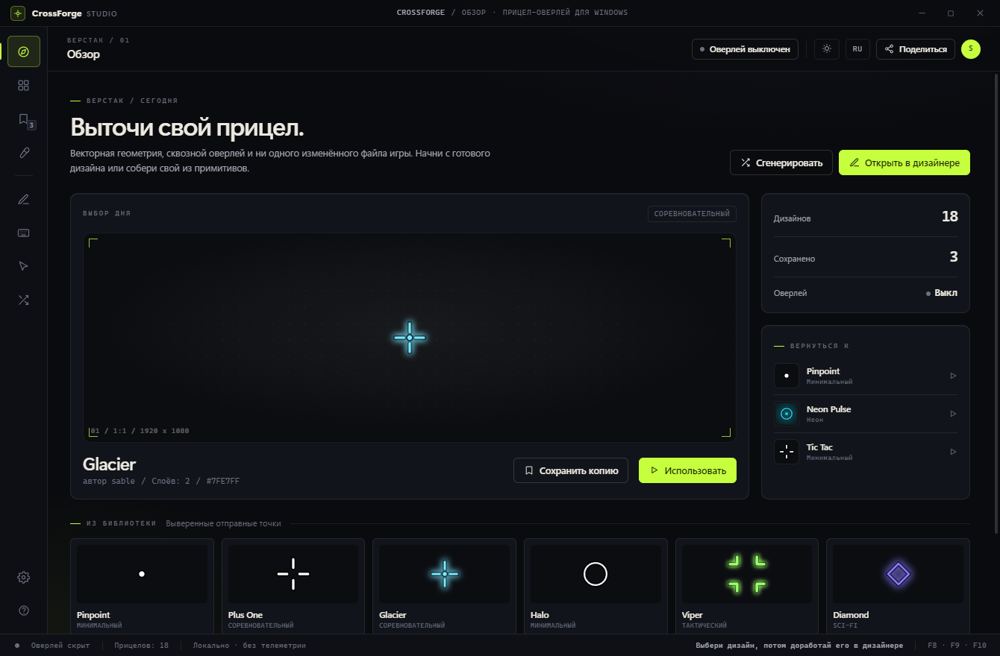
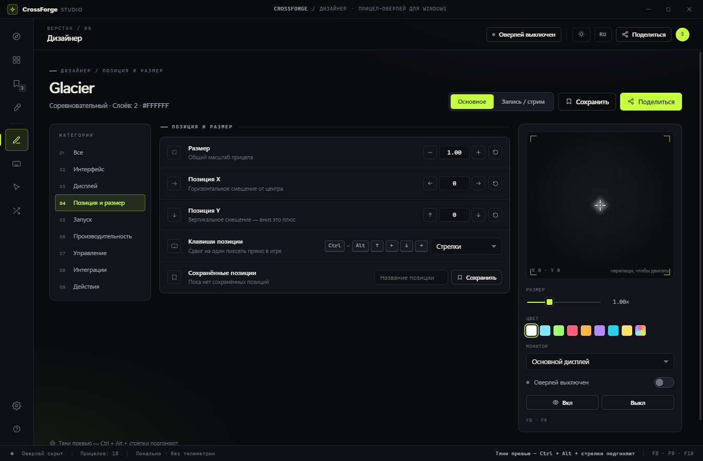
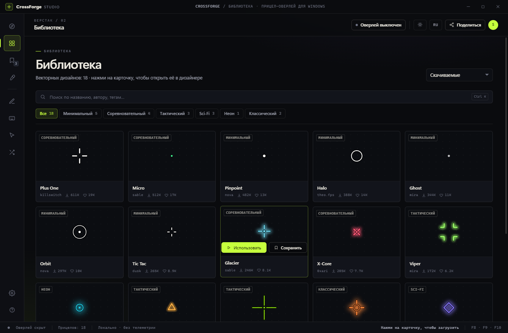
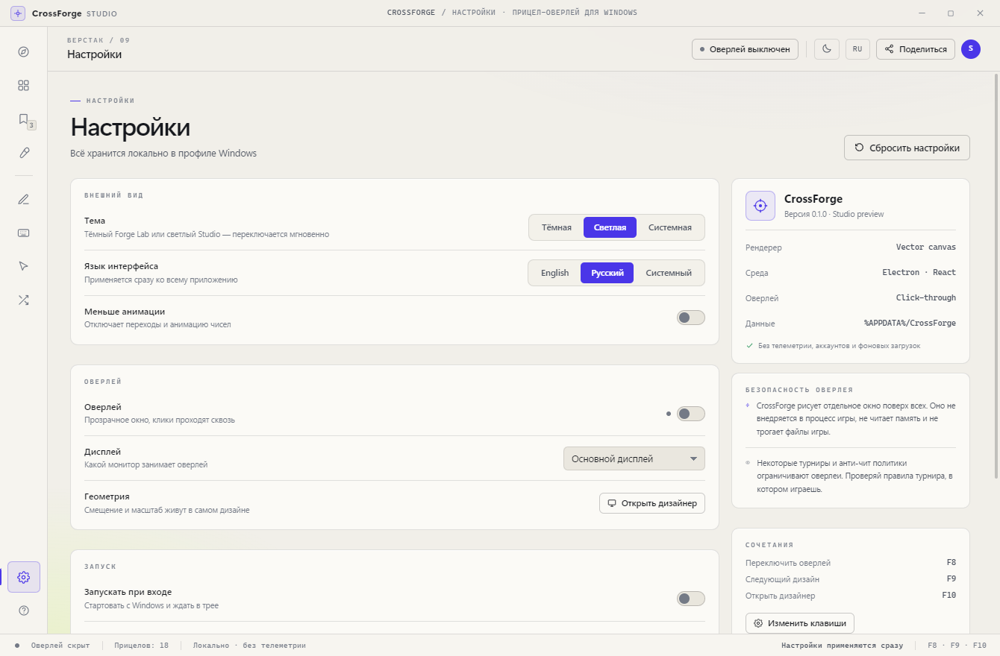

# CrossForge

**Crosshair overlay for Windows.** Vector-crisp crosshairs, a click-through always-on-top
overlay and a studio-grade designer — no game files touched, no memory hooks.

Two themes (dark *Forge Lab*, light *Studio*) and two interface languages (English, Русский).



## What's inside

- **Transparent overlay window** — always on top, click-through, one display at a time.
- **Vector renderer** — every crosshair is drawn from shapes (`cross`, `dot`, `ring`,
  `brackets`, `triangle`, `square`), so it stays sharp at any resolution and any DPI.
- **Designer** — live preview with drag-to-position, size / offset steppers, per-layer
  editing, colour + outline + opacity + glow, saved positions.
- **18 bundled designs** with search, category filters, sorting and a randomizer.
- **Global hotkeys** — toggle overlay, cycle designs, open designer, plus 1-px position
  nudging with `Ctrl + Alt + arrows` (or numpad).
- **Share codes and files** — base64 share codes and `.crossforge.json` export/import.
- **Themes and languages** — dark and light palettes, English and Russian UI, switchable
  in Settings or from the header.
- **Local-first storage** — settings and designs live in `%APPDATA%\CrossForge`.





## Quick start (dev)

```bash
npm install
npm run dev
```

`npm run dev` compiles the Electron main process, starts Vite on port 5273 and launches
the app against the dev server.

```bash
npm run build      # main + renderer
npm run start      # run the production build
npm run dist       # NSIS installer -> release/CrossForge-Setup-<version>.exe
npm run test       # i18n dictionary checks (node --test)
```

## Where things live

| Area | Path |
| --- | --- |
| Main process, overlay window, hotkeys, tray | `electron/` |
| Shared types, presets, share codes | `shared/` |
| React UI | `src/` |
| Design tokens and both themes | `src/styles/global.css` |
| Crosshair renderer | `src/crosshair/render.ts` |
| English / Russian dictionaries | `src/i18n/en.ts`, `src/i18n/ru.ts` |
| Installer config | `electron-builder.yml` |

## Localization

- `Settings.language` is `en`, `ru` or `system` (follows the Windows display language).
- `ru` is typed as `Record<MessageKey, string>`, so a missing key fails the build.
- `npm run test` checks key coverage, empty values and `{placeholder}` parity.

## Overlay notes

- Works best with **borderless / windowed** games. Exclusive fullscreen bypasses every
  desktop overlay, CrossForge included.
- The close button sends CrossForge to the **system tray** — the overlay keeps working and
  hotkeys stay registered. Quit from the tray menu. Launching the app again restores the
  window instead of starting a second copy.
- The overlay window is click-through and does not forward mouse moves, so it never
  fights with the system cursor.
- Designer → Position: nudge the crosshair with `Ctrl + Alt + arrows` while a game has
  focus.
- Recording / Streaming tab can hide the crosshair from OBS and Game Bar via Windows
  display affinity (`setContentProtection`).
- CrossForge never injects into game processes and never reads game memory. Tournament
  and anti-cheat rules still apply — check the rules of the event you play in.

## Not wired up yet

Steam Workshop and the online community are intentionally stubbed in this build: the
UI shows the destination, but publishing needs a backend. Share codes, file export and
import all work offline.

## Stack

Electron 33 · React 18 · TypeScript 5.7 · Vite 5 · electron-builder 25 (NSIS).
